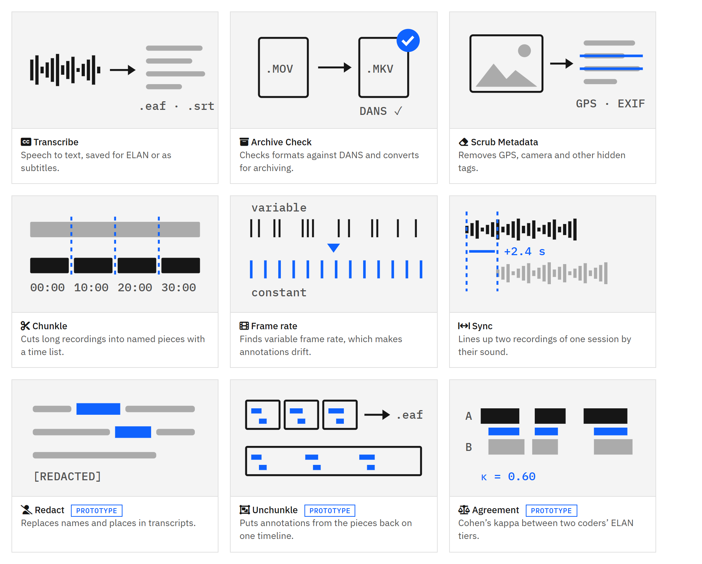

# MEDIAPREP

A local **"collect & prepare media"** workbench with a clean single-page UI. Nine
tools behind one sidebar, all running on your own machine — you point them at local
files or folders and **nothing is uploaded anywhere**:

1. **Transcribe** — audio/video → **SRT / WebVTT / plain text / ELAN `.eaf`**, using
   local [faster-whisper](https://github.com/SYSTRAN/faster-whisper). Sensitive audio
   never leaves your laptop.
2. **Archive Check** — inspect codecs & containers, flag them against
   [DANS preferred formats](https://dans.knaw.nl/en/file-formats/), and convert to a
   preservation master.
3. **Scrub Metadata** — find and remove EXIF, GPS, and embedded tags from images and
   A/V before you share.
4. **Chunkle** — cut long recordings into pieces of a fixed length (for example
   10 minutes). Each piece is named after where it starts, and a `chunks.csv`
   records its exact start and end in the original, so annotations made on a piece
   (for example in ELAN) can be moved back onto the full recording.
5. **Frame rate** — detect variable frame rate (common in phone and screen recordings,
   and a cause of drifting ELAN annotations) and convert to a constant rate.
6. **Sync** — find the time offset between two recordings of the same session from their
   sound, and write an aligned copy.

*Transcripts & coding (prototypes):*

7. **Redact** — replace names and places in a transcript (`.srt`, `.vtt`, `.txt`, `.eaf`),
   with suggestions for capitalised words.
8. **Unchunkle** — merge the ELAN files made on Chunkle pieces into one `.eaf` on the
   full recording's timeline.
9. **Agreement** — Cohen's kappa over time and annotation matching between two coders'
   ELAN tiers.

<picture>
  <source media="(prefers-color-scheme: dark)" srcset="docs/tools-dark.png">
  
</picture>

Companion to [VideoDrop](https://github.com/babajideowoyele/videodrop): *download →
transcribe → prepare → archive*.

## Prerequisites

| Tool     | Needed for | Install |
|----------|------------|---------|
| Python 3.8+ | everything | [python.org](https://www.python.org/downloads/) |
| ffmpeg / ffprobe | Chunkle, archive check, scrub, transcribe | Windows: `winget install Gyan.FFmpeg` · macOS: `brew install ffmpeg` · Linux: `apt install ffmpeg` |
| faster-whisper | transcription | `pip install -U faster-whisper` |
| Pillow   | image metadata scrub | `pip install -U Pillow` |

An NVIDIA GPU is optional — transcription runs on CPU by default and offers a **GPU
(CUDA)** option when a GPU is detected (needs CUDA/cuDNN libraries).

## Quick start

**Windows, no command line:** on the GitHub page click **Code → Download ZIP**, unzip it,
and double-click **`Start MediaPrep.bat`**. It checks for Python and ffmpeg, offers to
install what is missing (with Windows' own `winget`), and opens MediaPrep in your browser.
Chunkle needs only Python and ffmpeg; Transcribe also needs faster-whisper.

**Any system:**

```bash
git clone https://github.com/babajideowoyele/mediaprep.git
cd mediaprep
python app.py          # use python3 on macOS/Linux
```

It prints the address and opens `http://127.0.0.1:7655`. Press `Ctrl+C` to stop.
On Windows you can also run `run.ps1`.

## Transcribe, Archive Check and Scrub

### Transcribe
Point it at an audio or video file, pick a Whisper model (tiny → large-v3), a language
(or auto-detect), CPU or GPU, and which formats to write. Outputs land next to the
source file. The first run of a given model downloads it from Hugging Face (cached
after that). The **ELAN `.eaf`** output opens directly in ELAN with a `transcription`
tier aligned to the media.

### Archive Check
Point it at a file or a folder (scanned recursively). Each file is classified against
the DANS preferred-format list:

- **preferred** — a DANS preferred format (Matroska/MXF video, FLAC/OPUS audio,
  TIFF/PNG/JPEG/JP2 images).
- **acceptable** — widely used and accepted, but not on the preferred list (e.g. MP4,
  MP3) — a *remux to Matroska* or *convert to FLAC* is offered.
- **review** — an uncommon container/codec worth converting.

Per-row conversions: **MKV remux** (preferred container, keeps codecs, fast), **MKV /
FFV1** (lossless preservation master), **FLAC**, **TIFF/PNG**.

### Scrub Metadata
**Scan** a file or folder to see how much metadata each file carries and whether any
GPS is embedded, then **Scrub**:

- **Images** are rebuilt pixel-only — all EXIF, GPS, thumbnails, and captions dropped.
- **Audio/video** keep their streams (fast stream-copy) but all format/stream tags and
  chapters are removed.

By default it writes `_clean` copies; tick **Overwrite** to replace the originals.
(ffmpeg re-adds a few harmless technical container tags such as `encoder`/`major_brand`;
your private tags — title, comment, location/GPS — are gone.)

## Configuration

- **Port** — edit `PORT` at the top of `app.py` (default 7655).
- **Concurrent jobs** — edit `WORKERS` (default 2).

## Troubleshooting / FAQ

**Transcribe fails downloading the model / SSL error.**
Some Anaconda-on-Windows setups export a broken `SSL_CERT_FILE`. MediaPrep repairs it
automatically at startup (using `certifi`); if you still see SSL errors, run
`pip install -U certifi`.

**"faster-whisper not installed" note at the top.**
`pip install -U faster-whisper`, then restart. (Archive Check and Scrub still work
without it.)

**GPU option errors mid-transcription.**
CUDA transcription needs matching cuDNN libraries. If it fails, switch **Device** back
to CPU — slower but dependency-free.

**"file not found" / nothing shows up.**
Paste the **full absolute path** (e.g. `C:\Users\you\Videos\clip.mp4`). For a folder,
it scans recursively up to 500 media/image files.

**Scrubbed video still lists a few tags.**
Those are ffmpeg's own technical container tags (`encoder`, `major_brand`, …), not your
data. Everything identifying — title, comment, GPS/location, chapters — is removed.

**First model run is slow.**
It downloads the Whisper model once (~75 MB tiny → ~3 GB large). Later runs reuse the
cache in `~/.cache/huggingface`.

## License

MIT — see [LICENSE](LICENSE).

## Chunkle: cutting long recordings

1. Open **Chunkle** in the sidebar and paste the full path of the recording.
2. Pick a length (5–30 minutes) and how to cut:
   - **Fast** copies the video without re-encoding and cuts at the nearest keyframe, so a
     piece can be a fraction of a second longer or shorter. Original quality, very quick.
   - **Exact** cuts on the second and re-encodes to MP4 (H.264/AAC). Slower, smaller files,
     which also helps with upload limits (MaskAnyone's standard setup accepts 200 MB).
3. The pieces go into `<name>_chunks/` next to the recording, for example
   `session03_part02_00h10m00s.mp4`, together with `chunks.csv` and a short `README.txt`.

To move ELAN annotations from a piece back to the full recording, open the piece's `.eaf`
and use **Edit → Shift All Annotations…** with that piece's `start_seconds` from
`chunks.csv`. Cut the masked and the original version with the same settings so their
pieces line up. Or let **Unchunkle** do it: point it at the `_chunks` folder after
saving each piece's `.eaf` next to the piece with the same name.

## Prototypes: check the output

Frame rate, Sync, Redact, Unchunkle and Agreement are early prototypes. They never change
the original files, but check their output before relying on it: open a converted or
aligned video next to the original, read a redacted transcript in full (names can be
misspelled or in lower case), and open a merged `.eaf` in ELAN. Sync works best with a
clear shared sound (a clap at the start) and uses the first three minutes.
